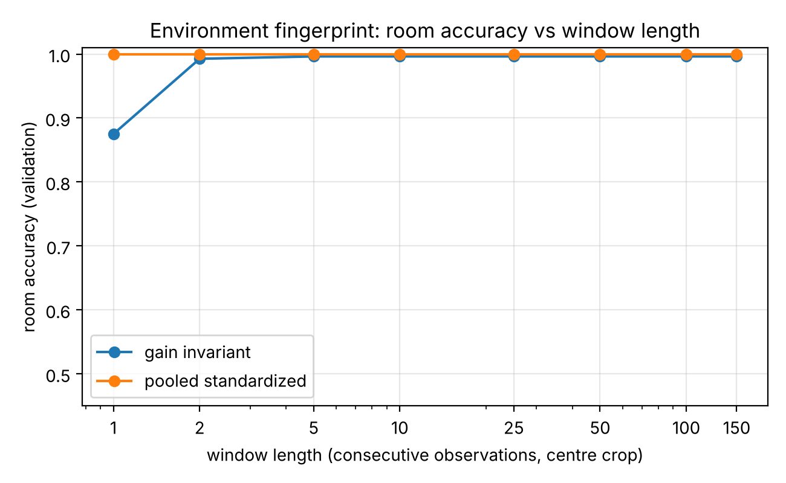
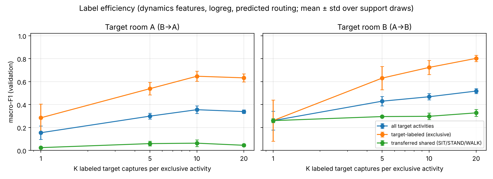
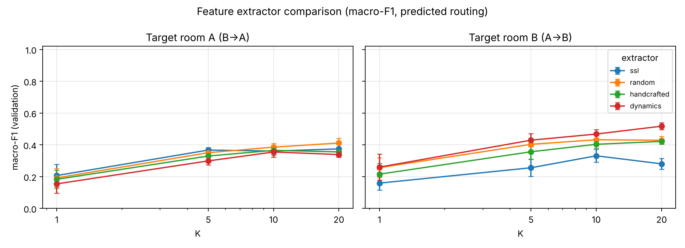
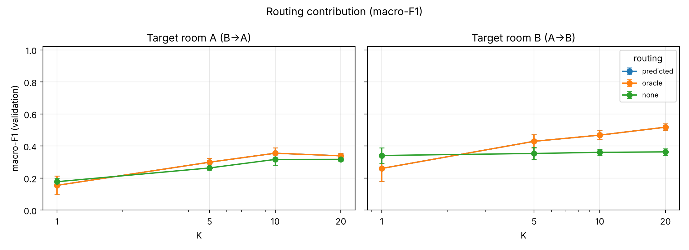
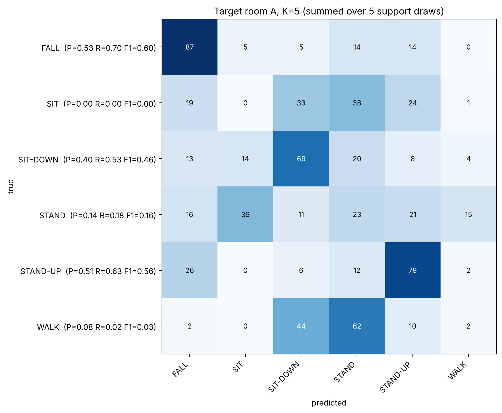
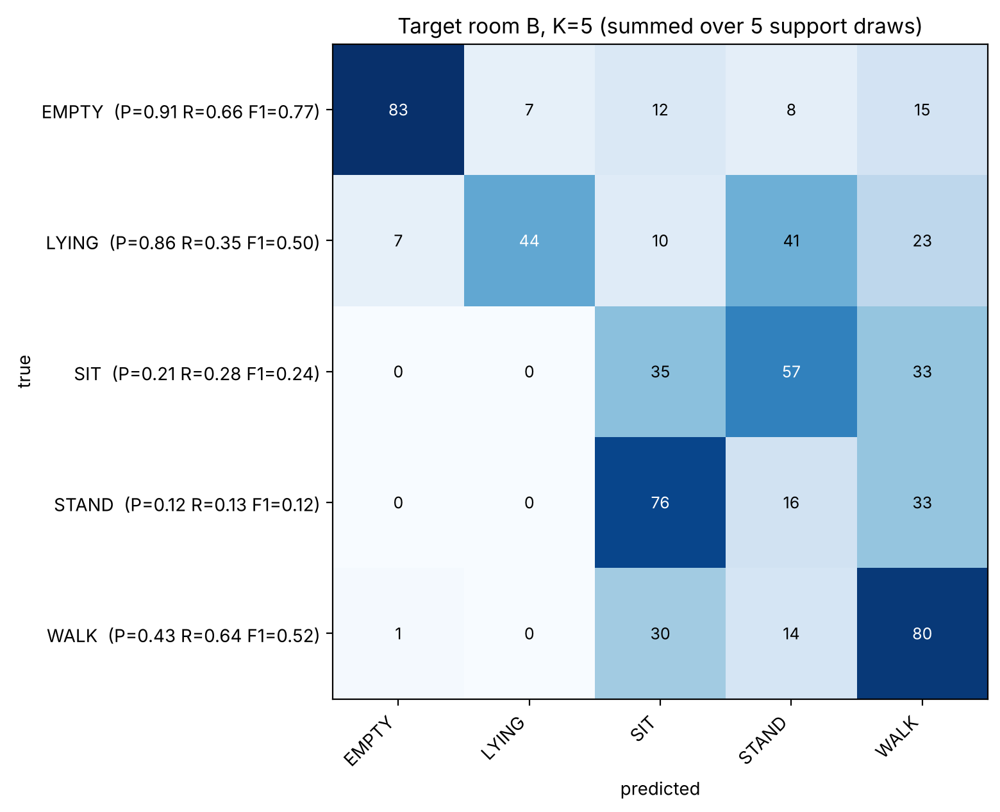

# Cross-Room Few-Shot Adaptation for WiFi CSI Activity Recognition

**CS60055 Ubiquitous Computing — Hackathon Challenge 2 — Technical report (draft)**

*Team: Member 1 (preprocessing), Member 2 (self-supervised learning), Member 3 (integration, Task 1, Task 3, episode runner). Replace with names and roll numbers.*

> All numbers are **validation results** on the fixed challenge validation sets, produced by `python scripts/run_all.py`. They are not unseen-test accuracy.

---

## 1. Problem and summary

A WiFi sensing model trained in one room carries that room's channel characteristics with it. The challenge asks for three things:

1. Build a clean, leakage-safe CSI pipeline from two differently formatted recordings:
   * Room A: raw Nexmon `.pcap` (Experiment-2).
   * Room B: amplitude `.csv` (Experiment-3).
2. Learn representations without labels.
3. Recognize activities in a target room from the other room's labels, plus only K labeled target captures per target-exclusive activity.

Main findings:

* **Preprocessing** reproduces the expected archive exactly:
  * 1,084 + 1,201 captures in; 2,001 development and 272 validation windows of 150 × 256 out.
  * A bit-exact vectorized decoder.
  * Regenerated normalization statistics identical to the original team baseline.
* **Task 1:** the room can be identified with **100 %** validation accuracy from the window alone, even from a single CSI observation. The static multipath (and session) fingerprint is very strong.
* **Task 2:** a masked-reconstruction CNN encoder reaches macro-F1 0.855 in a frozen linear probe. That is not better than the same CNN with random weights (0.838–0.861), and clearly below handcrafted temporal statistics (0.955).
* **Task 3:** few-label adaptation works for target-exclusive activities: macro-F1 rises from 0.26–0.28 at K=1 to 0.63–0.80 at K=20. The transfer of SIT/STAND/WALK across rooms without target labels largely fails, giving all-activity macro-F1 of 0.52 (A→B) and 0.34 (B→A) at K=20.
  * A controlled probe shows why: a 3-class shared-activity classifier scores 0.97–0.99 within a room but 0.35 (A→B) and 0.03 (B→A) across rooms.
  * This quantifies the room/session and activity–location confounds the challenge lists as known limitations.
* **Environment-aware routing** adds +0.07 macro-F1 on average for K ≥ 5.

## 2. Pipeline

```text
 Experiment-2 .pcap (Room A)                 Experiment-3 .csv (Room B)
        │ pcap_reader.py: libpcap records → Eth/IPv4/UDP payload       │ header row, 256 numeric columns
        │ keep 1,042-byte payloads with magic 0x1111                   │
        │ decode 256 packed BCM4366c0 words → complex CSI → |CSI|      │
        └───────────────┬──────────────────────────────────────────────┘
                        ▼
      common form: one CSV per capture, subcarrier_001 … subcarrier_256, temporal order kept
                        ▼
      quality control: drop non-finite / all-zero / duplicate consecutive observations
                        ▼
      centre window: 150 consecutive valid observations (captures < 150 excluded)
                        ▼
      normalization (fitted on DEVELOPMENT only): per-room A, B  |  pooled (both rooms)
                        ▼
   ┌────────────────────┼──────────────────────────────┐
   ▼                    ▼                              ▼
 Task 1 router     Task 2 SSL encoder            Task 3 adapted classifier
 (pooled input)    (room-normalized input)       routed room → normalization
                                                 → features → per-room alignment
                                                 → classifier
                        ▼
            run_episode.py → window_id, room, label, confidence
```

Every stage reads `configs/experiment.yaml`. The batch builder and `run_episode.py` import the same functions (`src/pipeline/ingest.py`), so development, validation and unseen episodes go through identical code.

## 3. Data engineering

### 3.1 Source inspection

* **Room A** captures are classic libpcap files.
  * Each CSI frame is a UDP datagram carrying an 18-byte Nexmon header (magic `0x1111`, RSSI, frame control, source MAC, sequence number, core/stream, chanspec, chip version) and 1,024 bytes of CSI.
  * That is 256 little-endian 32-bit words, matching 256 subcarriers at 80 MHz.
  * Captures hold 112–251 valid frames (median 221).
  * The folder name `30ms` is not a capture duration.
* **Room B** CSVs have a header row and exactly 500 rows × 256 numeric columns.
  * Two header styles occur: integer indices (e.g. `Empty_11.csv`) and `Subcarrier_*`.
  * There are no missing or non-finite values.

### 3.2 PCAP parsing and CSI reconstruction

We wrote a dependency-free libpcap reader (`src/preprocessing/pcap_reader.py`). It handles both byte orders and µs/ns timestamps, and the Ethernet (with VLAN), Linux SLL and raw-IPv4 link types. It parses IPv4/UDP headers and counts incomplete records instead of printing warnings.

On the full archive it reads 234,021 records. Exactly 2 are truncated and rejected: these are the two "truncated packet" warnings seen earlier with Scapy.

Each CSI word packs:

* a real part: sign bit 29, mantissa bits 18–28,
* an imaginary part: sign bit 17, mantissa bits 6–16,
* a shared 6-bit two's-complement exponent: bits 0–5.

The decoder rescales each packet so that its largest exponent-adjusted component occupies 11 bits (packet-wise scaling), then shifts each subcarrier's mantissas by its exponent offset. Amplitude is |real + j·imag|.

Member 1's scalar decoder was spot-checked against `csiread` and matched it. Our vectorized version (`decode_csi_batch`) is verified bit-identical to that scalar decoder on 400 random packets (including empty and extreme-exponent cases) and on real packets (`scripts/verify_decoder.py`). It decodes the whole archive in seconds.

### 3.3 Quality control

Per observation, QC removes non-finite rows, all-zero rows (no CSI information) and exact consecutive duplicates (repeated frames). It also counts negative values. A capture is rejected if fewer than 50 % of its observations survive.

On the real data QC removes nothing: 0 zero, 0 duplicate, 0 non-finite and 0 negative rows. The checks are still active for unseen episodes, and are exercised by the synthetic smoke test, which injects zero-CSI frames and foreign UDP packets.

### 3.4 Windowing, splits, normalization and provenance

* **Window.** A deterministic centre crop: start = ⌊(N − 150)/2⌋ over valid observations. Windows never mix captures.
  * 12 Room A captures (9 development, 3 validation) have fewer than 150 valid frames and are excluded from the benchmark.
  * So Room A validation uses 147 of 150 captures. This is reported explicitly and not hidden.
* **Splits.** The original capture is the split unit.
  * Room A uses the supplied `validation/` folder (934/150).
  * Room B: sorted filenames, `random.Random(42)`, 25 per activity (1,076/125). The builder re-derives this split and confirms it matches the committed manifest.
* **Normalization.** Per-subcarrier z-score fitted on development windows only, in three variants:
  * room A,
  * room B,
  * pooled (both rooms, without room labels).

  The room-specific statistics are needed because absolute amplitudes differ between the two recordings. Room A mean amplitudes per subcarrier span 4–1,330, Room B 30–616. Using room-specific statistics at test time requires knowing the room, which is exactly what Task 1 routing provides. The router itself therefore uses only pooled statistics.
* **Provenance.** `data/windows/manifest.csv` holds one row per original capture with:
  * window id, original path, room, label and split,
  * status (`ok` / `short` / `rejected_qc`),
  * window start,
  * packet, rejection and QC counts,
  * the hash of the `preprocessing` configuration block.

  Downstream scripts refuse windows built with a different configuration hash.

**Consistency with the original baseline.** The regenerated room statistics match the original committed ones exactly (maximum absolute difference 0.0), and Member 2's leakage audit, re-run on the regenerated windows, again finds 0 overlapping captures and 0 identical windows across splits.

## 4. Task 1 — recorded-environment identification

**Method.**

* The input is the 150 × 256 amplitude window, standardized with **pooled** statistics.
* Features: per-subcarrier temporal mean, standard deviation and mean absolute first difference (768 values).
* Classifier: StandardScaler + L2 logistic regression, trained on all development windows.
* No metadata (filename, extension, directory, capture length, packet count) is available to the classifier.

**Results.**

* **100.0 % validation accuracy** (147/147 Room A, 125/125 Room B).
* A gain-invariant variant removes each window's overall level by subtracting the window mean of log-amplitude, leaving only the spectral shape. It reaches 99.6 %.

**Environment fingerprint vs window length** (Figure 1, `results/task1/room_accuracy_vs_window.png`). Windows are centre-cropped to L ∈ {1, 2, 5, 10, 25, 50, 100, 150}, and dev and val are cropped identically.

* Pooled-standardized: 100 % at every length, including **L = 1**.
* Gain-invariant: 87.5 % at L = 1, 99.3 % at L = 2, and ≥ 99.6 % from L = 5.

**Interpretation.** The frequency-selective static multipath profile of each recording is a near-perfect fingerprint. Even with the gain removed, two observations suffice. Because the rooms were recorded in different sessions, the classifier may also use session-specific effects (gain state, firmware configuration), so we describe this as recorded-environment identification, not physical-room recognition.



## 5. Task 2 — self-supervised representation (Member 2)

**Method.**

* Encoder: a 1-D CNN over time with 256 subcarriers as input channels. Three Conv1d layers (256→128→128→64, kernels 5/5/3) with GroupNorm and ReLU, then global average pooling to a 64-d embedding.
* Pretraining: masked reconstruction. 20 % of time steps are zeroed and MSE is computed on the masked positions only. A 1×1-conv decoder is used. Training: 10 epochs, AdamW at 1e-3, batch 16, seed 42.
* Data: development windows of both rooms, without any labels.
* Evaluation: frozen encoder → StandardScaler + class-balanced logistic regression on labeled development windows → scored on validation, over all 8 activities.

| Representation | Macro-F1 | Balanced accuracy |
|---|---:|---:|
| SSL encoder | 0.855 | 0.875 |
| Same CNN, random weights | 0.861 (PyTorch init) / 0.838 (NumPy init) | 0.876 / 0.848 |
| Handcrafted statistics (768) | 0.959 (original run) / 0.955 (re-run) | 0.965 / 0.960 |

The pretrained encoder is evaluated in NumPy in the rest of the pipeline. A minimal reader for PyTorch's zip checkpoint format plus a NumPy forward pass reproduces the PyTorch linear-probe result exactly (0.8546 / 0.8753).

The reconstruction loss fell by 26 %, but that did not translate into better activity features than random convolutional features. t-SNE (`results/encoder_diagnosis/`) shows the embeddings separate first by room and only secondarily by activity.

## 6. Task 3 — cross-room few-label adaptation

### 6.1 Protocol

For target room T and source room S:

* **Classes.** The label space is T's activities.
  * Shared activities (SIT, STAND, WALK) are learned only from S's labeled development windows.
  * Target-exclusive activities (A: SIT-DOWN, STAND-UP, FALL; B: EMPTY, LYING) get K distinct target **development** captures each. One window per capture, so K captures = K shots.
* **K and repetitions.** K ∈ {1, 5, 10, 20}, each repeated with 5 independent support draws (seeds 0–4).
* **Evaluation.** On every eligible validation window of T (147 for A, 125 for B).
* **Metrics.** Macro-F1 over T's activities (primary), target-exclusive macro-F1, shared macro-F1 and balanced accuracy.

### 6.2 Method

1. **Routing.** The Task 1 router assigns each window a room/domain. Its development statistics normalize the window, and per-domain feature alignment standardizes the extracted features using the mean and std of that domain's *unlabeled* development features. The alignment removes first-order domain shift without target labels, and both statistics come from development data only.
2. **Features.** We compare four extractors:
   * the Task 2 SSL encoder,
   * the same CNN with random weights,
   * handcrafted mean/std/diff features (768),
   * **dynamics**: std and diff only (512). This drops the per-subcarrier mean, which is dominated by each room's static multipath and by the person's location.
3. **Classifier.** Class-balanced logistic regression on the union of aligned source shared-activity windows and aligned target support windows. A prototypical (nearest class mean) classifier is also reported.
4. **Ablation.** Routing is set to predicted (deployable), oracle (true room) or none (pooled normalization and alignment, the same model without routing).

### 6.3 Results

**Table 1. Headline system** (dynamics + logistic regression + predicted routing). Mean over 5 support draws; ± is std.

| Direction | K | Macro-F1 | Target-exclusive | Shared | Balanced acc. |
|---|---:|---:|---:|---:|---:|
| A→B | 1 | 0.260 ± 0.082 | 0.260 | 0.260 | 0.274 |
| A→B | 5 | 0.429 ± 0.041 | 0.630 | 0.295 | 0.413 |
| A→B | 10 | 0.468 ± 0.027 | 0.723 | 0.297 | 0.453 |
| A→B | 20 | 0.517 ± 0.022 | 0.802 | 0.327 | 0.507 |
| B→A | 1 | 0.154 ± 0.058 | 0.284 | 0.024 | 0.147 |
| B→A | 5 | 0.299 ± 0.026 | 0.538 | 0.059 | 0.343 |
| B→A | 10 | 0.355 ± 0.033 | 0.647 | 0.063 | 0.425 |
| B→A | 20 | 0.339 ± 0.016 | 0.633 | 0.045 | 0.429 |



**Table 2. Feature extractors** (macro-F1, mean over both directions and all K; logistic regression, predicted routing). Per-K values are in `results/task3/summary.csv` and Figure 3.

| SSL | Random CNN | Handcrafted | Dynamics |
|---:|---:|---:|---:|
| 0.292 | 0.357 | 0.329 | 0.353 |

The random-weight CNN is ahead of dynamics by 0.002–0.008 on every seed, a negligible margin. We use dynamics as the default because it is parameter-free, interpretable and excludes the room fingerprint by construction. This choice was made on the validation comparison, which the challenge permits for design decisions.



**Table 3. Routing contribution** (dynamics + logistic regression, macro-F1).

| Routing | A→B 1 | 5 | 10 | 20 | B→A 1 | 5 | 10 | 20 |
|---|---:|---:|---:|---:|---:|---:|---:|---:|
| Predicted | 0.260 | 0.429 | 0.468 | 0.517 | 0.154 | 0.299 | 0.355 | 0.339 |
| Oracle | 0.260 | 0.429 | 0.468 | 0.517 | 0.154 | 0.299 | 0.355 | 0.339 |
| None | 0.341 | 0.353 | 0.360 | 0.363 | 0.177 | 0.263 | 0.316 | 0.317 |



**Confusion matrices at K = 5** (Figure 5, summed over the 5 support draws; per-class precision, recall and F1 in `results/task3/per_class_K5_target_*.csv`):

* **Target A.** FALL F1 0.60, STAND-UP 0.56, SIT-DOWN 0.46, STAND 0.16, SIT 0.00, WALK 0.03.
* **Target B.** EMPTY 0.77, LYING 0.50, WALK 0.52, SIT 0.24, STAND 0.12.




### 6.4 Why the shared activities do not transfer

To separate the "few-shot" part from the "cross-room" part, `src/analysis/shared_transfer_probe.py` trains a 3-class SIT/STAND/WALK classifier on one room's development data, with the same features and alignment, and tests it on the shared validation captures of each room.

| Features | Train A → test A | Train A → test B | Train B → test B | Train B → test A |
|---|---:|---:|---:|---:|
| Dynamics | 0.972 | 0.345 | 0.987 | 0.027 |
| Handcrafted | 0.972 | 0.193 | 0.987 | 0.095 |
| Random CNN | 0.903 | 0.411 | 0.920 | 0.222 |
| SSL CNN | 0.959 | 0.043 | 0.907 | 0.250 |

Chance is 0.33.

* Within a room, the shared activities are almost perfectly separable.
* Across rooms, transfer is at or below chance, and B→A is systematically inverted: Room-A SIT and WALK are mostly predicted as STAND, and Room-A STAND as SIT.
* This is the expected effect of two documented confounds:
  * (i) room and session are inseparable;
  * (ii) in Experiment 2, activities were performed in different spatial zones, so an activity's CSI signature partly encodes *where* the person was.
* Feature-level alignment cannot undo a class-dependent mapping that differs between recordings. Without at least some target labels for the shared activities, this benchmark gives the model no information to recover it.

Three variants were tried and not adopted: subcarrier-order-invariant motion/spectral features, CORAL covariance alignment, and confidence-based self-training on unlabeled target development windows. None improved shared-activity transfer on validation.

### 6.5 Answers to the central questions

* **Label efficiency.** Target-exclusive macro-F1 roughly doubles to triples from K=1 to K=10. The gain flattens by K=10–20, especially for B→A. The overall macro-F1 ceiling is set by the shared activities.
* **Self-supervised pretraining.** It did not help here. The SSL encoder is below a random-weight encoder of the same architecture in both Task 2 and Task 3. Masked reconstruction rewards modelling the dominant static multipath, which is room-specific, rather than activity dynamics.
* **Environment-aware routing.** It helps (+0.07 mean macro-F1 for K ≥ 5, up to +0.15) once a few target shots anchor the target feature space. It slightly hurts at K=1. Predicted routing equals oracle routing because Task 1 is 100 % accurate.

## 7. End-to-end system

`run_episode.py --episode DIR [--support support.csv]` accepts `.pcap`, `.csv` and/or `.npy` captures and runs the same pipeline. It writes `window_id, room, label, confidence`, plus a details file with packet, QC and window information.

* Captures shorter than 150 observations are edge-padded **at inference only** and flagged.
* An optional support CSV (`path,label`) supplies episode-specific K-shot captures. They are routed and replace the stored development support for that room.

Tests:

* On 35 real validation captures from both rooms (including a short capture and a `.npy` window), routing is 35/35 correct.
* The synthetic smoke test (`scripts/smoke_test.py`) checks every output file and the prediction format.

## 8. Leakage controls

* The capture is the split unit. Validation captures are never used for fitting, normalization, alignment or support.
* All statistics come from development data: pooled, per-room and feature-alignment.
* No metadata features are used. File format only selects the parser.
* Every derived window carries its source capture and configuration hash.
* Stated deviation: 3 official Room A validation captures cannot form a strict 150-observation window and are excluded.

## 9. Limitations

1. Room and session are confounded, so Task 1 may partly detect the session.
2. Activity and location are confounded in Experiment 2. This limits shared-activity transfer (section 6.4).
3. Only two environments are used; there is no claim about unseen rooms.
4. The split is capture-disjoint, not subject-disjoint.
5. Three Room A validation captures are excluded (too short).
6. Design choices (feature extractor, routing) were compared on validation, so the reported numbers are optimistic relative to a truly held-out test.

## 10. Contribution statement

* **Member 1:** data inspection, Room A PCAP decoding (packed-CSI reconstruction, `csiread` spot check), Room B ingestion, split manifests, windowing, normalization, data audit.
* **Member 2:** CNN encoder, masked-reconstruction pretraining, frozen linear probe, random and handcrafted baselines, leakage audit, t-SNE.
* **Member 3:**
  * Integration into one config-driven pipeline with QC and a provenance manifest.
  * Dependency-free PCAP reader and vectorized, verified decoder.
  * Task 1 router and fingerprint study.
  * NumPy encoder inference.
  * Task 3 adaptation, routing ablation and shared-transfer probe.
  * `run_episode.py`, smoke test and documentation.

## 11. AI-use disclosure

AI assistance (Anthropic's Claude) was used for code drafting, debugging, verification scripts and documentation, including this report draft. All results were produced by running the repository's scripts on the challenge data. The team reviewed the code and is responsible for explaining every stage.

No source-author MATLAB code, processed `.mat` files or the Experiment-3 LSTM notebook were used.

## References

1. CS60055 Hackathon Challenge 2: *Cross-Room Few-Shot Adaptation*.
2. J. Schäfer et al., "Human Activity Recognition Using CSI Information with Nexmon," *Applied Sciences* 11(19):8860, 2021.
3. CSI Human Activity dataset, IEEE DataPort. https://ieee-dataport.org/open-access/csi-human-activity
4. Nexmon CSI. https://github.com/seemoo-lab/nexmon_csi
5. J. Snell, K. Swersky, R. Zemel, "Prototypical Networks for Few-shot Learning," NeurIPS 2017.
6. B. Sun, K. Saenko, "Deep CORAL: Correlation Alignment for Deep Domain Adaptation," ECCV Workshops 2016.
7. K. He et al., "Masked Autoencoders Are Scalable Vision Learners," CVPR 2022 (masked-reconstruction pretraining).
